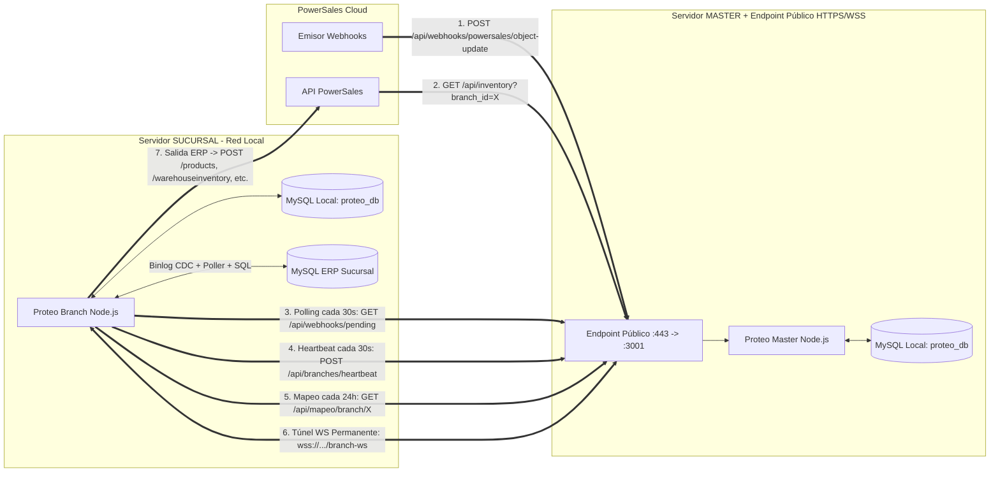

# Guía de Despliegue a Producción — Proteo (PowerSales Sync)

Este documento contiene el procedimiento completo paso a paso para poner en marcha **Proteo** en un nuevo entorno productivo bajo el esquema **Servidor Master (Central) + Servidores de Sucursal (Branch) + Endpoint Público**.

---

## 1. Arquitectura de Red y Flujo del Endpoint

El **único servidor que requiere un Endpoint público (HTTPS/WSS)** expuesto a internet es el **Servidor Master**. Las sucursales operan detrás de su red local sin necesidad de abrir puertos entrantes.



### Resumen de Endpoints Expuestos en el Master

| Método / Protocolo | Ruta del Endpoint Público | Propósito | Consumidor | Autenticación |
| :--- | :--- | :--- | :--- | :--- |
| `POST` | `/api/webhooks/powersales/object-update` | Recibir actualizaciones de artículos, clientes, pedidos y cotizaciones desde PowerSales. | PowerSales Cloud | `Authorization: Bearer <PS_TOKEN>` |
| `GET` | `/api/inventory?branch_id=X&ProductId=Y&WarehouseId=Z` | Consultar en tiempo real la existencia de un almacén/producto en una sucursal vía WebSocket. | PowerSales / Externo | `Authorization: Bearer <PS_TOKEN>` |
| `GET` | `/api/webhooks/pending?branch_id=X&after_id=N` | Descargar webhooks pendientes asignados a una sucursal específica. | Sucursales | `Authorization: Bearer <PS_TOKEN>` |
| `POST` | `/api/branches/heartbeat` | Recibir reporte de estado y métricas diarias de cada sucursal. | Sucursales | `Authorization: Bearer <PS_TOKEN>` |
| `GET` | `/api/mapeo/branch/:branchId` | Entregar configuración de mapeo de columnas ERP ↔ PowerSales a la sucursal. | Sucursales | `Authorization: Bearer <PS_TOKEN>` |
| `WSS` | `/branch-ws?branch_id=X` | Canal WebSocket bidireccional para consultas de inventario en tiempo real. | Sucursales | `Authorization: Bearer <PS_TOKEN>` |

---

## 2. Requisitos Previos (En Master y en cada Sucursal)

| Componente | Versión Mínima | Notas |
| :--- | :--- | :--- |
| **Node.js** | v18.x o superior | Incluye `npm` 9+ |
| **MySQL Local** | 5.7+ / 8.0+ | Para la base de datos interna `proteo_db` (puede ser XAMPP o MySQL Server) |
| **MySQL ERP** | 5.7+ | Con tabla `Cambios`, triggers instalados y (opcionalmente) `binlog` en formato `ROW` |
| **PM2** | Última versión | `npm install -g pm2` para mantener el proceso activo 24/7 |

---

## 3. Preparación de la Base de Datos del ERP (En cada Sucursal / ERP Productivo)

Ejecuta estos pasos sobre la base de datos MySQL del **ERP** que se va a sincronizar:

### 3.1. Verificar estructura de la tabla `Cambios`
Asegúrate de que la tabla `Cambios` soporte el estado `2` (error) y las columnas de control utilizadas por Proteo:

```sql
CREATE TABLE IF NOT EXISTS `Cambios` (
  `id` INT AUTO_INCREMENT PRIMARY KEY,
  `tabla` VARCHAR(50) NOT NULL,
  `clave_registro` VARCHAR(100) NOT NULL,
  `campos_modificados` TEXT,
  `fecha_cambio` DATETIME DEFAULT CURRENT_TIMESTAMP,
  `sincronizado` TINYINT UNSIGNED NOT NULL DEFAULT 0 COMMENT '0=pendiente, 1=ok, 2=error',
  `fecha_sync` DATETIME DEFAULT NULL,
  `error_sync` TEXT DEFAULT NULL,
  `procesado_por` VARCHAR(50) DEFAULT NULL,
  INDEX `idx_sincronizado` (`sincronizado`),
  INDEX `idx_tabla_clave` (`tabla`, `clave_registro`)
) ENGINE=InnoDB DEFAULT CHARSET=utf8mb4;

-- Si la tabla ya existía con esquema antiguo, asegura los tipos y columnas:
ALTER TABLE `Cambios` MODIFY COLUMN `sincronizado` TINYINT UNSIGNED NOT NULL DEFAULT 0;
```

### 3.2. Instalar Triggers en el ERP
Ejecuta en la base de datos del ERP los scripts SQL incluidos en el repositorio:

1. **Inventario por almacén (`articuloalm`):** Ejecutar `triggers_articuloalm.sql`.
   > **Atención:** Revisa en `triggers_articuloalm.sql` la condición `IF USER() LIKE 'root@%' THEN`. Si los usuarios o el sistema ERP en producción se conectan a MySQL con otro usuario distinto a `root`, ajusta esa condición o elimínala para que capture todos los cambios del ERP.
2. **Surtido de pedidos (`surtidopedido`):** Ejecutar `triggers_surtidopedido.sql`.
3. **Artículos (`articulo`), Clientes (`clientes`) y Tipo de Cambio (`tipocamb`):** Verificar que estén activos sus respectivos triggers hacia la tabla `Cambios`.

### 3.3. Habilitar Binlog para CDC en Tiempo Real (Recomendado)
Para que Proteo detecte cambios en milisegundos vía `ZongJi` (además del Poller de respaldo de 5 segundos):

1. En el archivo `my.ini` (Windows) o `my.cnf` (Linux) del servidor MySQL del ERP:
   ```ini
   [mysqld]
   log_bin          = mysql-bin
   binlog_format    = ROW
   binlog_row_image = FULL
   server_id        = 1
   ```
2. Reinicia el servicio de MySQL del ERP y verifica:
   ```sql
   SHOW VARIABLES LIKE 'log_bin';        -- Debe devolver ON
   SHOW VARIABLES LIKE 'binlog_format';  -- Debe devolver ROW
   ```
3. Otorga permisos de replicación al usuario que usará Proteo en `BINLOG_USER`:
   ```sql
   GRANT REPLICATION SLAVE, REPLICATION CLIENT ON *.* TO 'binlog_reader'@'%';
   FLUSH PRIVILEGES;
   ```
   *(Nota: Si MySQL es versión 8.0+, el usuario `binlog_reader` debe crearse con `IDENTIFIED WITH mysql_native_password BY 'tu_password'` para compatibilidad con ZongJi).*

---

## 4. Despliegue en el SERVIDOR MASTER (Central)

### 4.1. Crear Base de Datos Local (`proteo_db`)
En el MySQL local del servidor Master (`127.0.0.1`), crea únicamente la base de datos vacía (el sistema creará las tablas `app_config`, `field_mapping`, `sync_history`, `webhook_logs`, `branch_status` y `field_mapping_overrides` automáticamente al arrancar):

```sql
CREATE DATABASE IF NOT EXISTS proteo_db CHARACTER SET utf8mb4 COLLATE utf8mb4_unicode_ci;
```

### 4.2. Configurar `backend/.env` del Master
En el servidor Master **NO se debe definir `CENTRAL_URL` ni `PS_BRANCH_ID`** para que opere en modo `master`:

```env
# ==========================================
# CONFIGURACIÓN SERVIDOR MASTER (PRODUCCIÓN)
# ==========================================

# 1. Base de datos ERP (si el Master también consulta un ERP central)
MYSQL_HOST=192.168.60.42
MYSQL_PORT=3306
MYSQL_DB=nombre_bd_erp_prod
MYSQL_USER=root
MYSQL_PASS=tu_password_erp

# Usuario Binlog (opcional en Master si no lee binlog directo)
BINLOG_USER=binlog_reader
BINLOG_PASS=Binlog2024!
BINLOG_SERVER_ID=100

# 2. API PowerSales Producción
PS_BASE_URL=https://api.powersales.cloud/api/grupoascencio
PS_TOKEN=PEGA_AQUI_EL_TOKEN_DE_PRODUCCION
PS_EMPRESA=00001

# IMPORTANTE: En el Master NO definir CENTRAL_URL ni PS_BRANCH_ID

# 3. Puertos locales
PORT=3001
WS_PORT=3002

# 4. Base de datos local de Proteo (Master)
LOCAL_MYSQL_HOST=127.0.0.1
LOCAL_MYSQL_PORT=3306
LOCAL_MYSQL_DB=proteo_db
LOCAL_MYSQL_USER=root
LOCAL_MYSQL_PASS=tu_password_mysql_local
```

### 4.3. Configurar el Endpoint Público (Reverse Proxy / Túnel)
El puerto `3001` del Master debe publicarse bajo un dominio con certificado SSL (`https://...`). Es indispensable habilitar el soporte para **WebSockets (`Upgrade`)** para que la ruta `/branch-ws` funcione.

#### Opción A: Nginx como Reverse Proxy (con Certbot SSL)
```nginx
server {
    listen 443 ssl;
    server_name sync.tudominio.com;

    ssl_certificate     /etc/letsencrypt/live/sync.tudominio.com/fullchain.pem;
    ssl_certificate_key /etc/letsencrypt/live/sync.tudominio.com/privkey.pem;

    client_max_body_size 50M;

    location / {
        proxy_pass http://127.0.0.1:3001;
        proxy_http_version 1.1;

        # Indispensable para el túnel WebSocket de sucursales (/branch-ws)
        proxy_set_header Upgrade $http_upgrade;
        proxy_set_header Connection "upgrade";

        proxy_set_header Host $host;
        proxy_set_header X-Real-IP $remote_addr;
        proxy_set_header X-Forwarded-For $proxy_add_x_forwarded_for;
        proxy_set_header X-Forwarded-Proto $scheme;

        proxy_read_timeout 300s;
        proxy_send_timeout 300s;
    }
}
```

#### Opción B: Cloudflare Tunnel (`cloudflared`)
Si expones el Master mediante Cloudflare Tunnel:
* Apunta el servicio público en el panel de Cloudflare Zero Trust a `http://localhost:3001`.
* Cloudflare Tunnel soporta WebSockets (`wss://`) de forma nativa sin configuración adicional.

---

## 5. Despliegue en el SERVIDOR DE SUCURSAL (Branch)

Repite este proceso en cada sucursal que vaya a sincronizar su propio ERP local.

### 5.1. Crear Base de Datos Local (`proteo_db`) en la Sucursal
En el MySQL local (`127.0.0.1`) de la máquina de la sucursal:

```sql
CREATE DATABASE IF NOT EXISTS proteo_db CHARACTER SET utf8mb4 COLLATE utf8mb4_unicode_ci;
```

### 5.2. Configurar `backend/.env` de la Sucursal
En la sucursal **SÍ es obligatorio definir `CENTRAL_URL` (apuntando al Endpoint del Master) y `PS_BRANCH_ID`**:

```env
# ============================================
# CONFIGURACIÓN SERVIDOR SUCURSAL (PRODUCCIÓN)
# ============================================

# 1. Base de datos ERP Local de la Sucursal
MYSQL_HOST=192.168.1.50
MYSQL_PORT=3306
MYSQL_DB=bd_erp_sucursal
MYSQL_USER=root
MYSQL_PASS=password_erp_sucursal

# Usuario Binlog del ERP de la Sucursal
BINLOG_USER=binlog_reader
BINLOG_PASS=Binlog2024!
# Usa un server_id único por sucursal (ej. 100 + PS_BRANCH_ID)
BINLOG_SERVER_ID=109

# 2. API PowerSales Producción
# NOTA: PS_TOKEN debe ser exactamente el mismo que tiene el servidor Master
PS_BASE_URL=https://api.powersales.cloud/api/grupoascencio
PS_TOKEN=PEGA_AQUI_EL_TOKEN_DE_PRODUCCION
PS_EMPRESA=00001

# 3. Identificador de Sucursal y Endpoint del Master (OBLIGATORIOS EN SUCURSAL)
PS_BRANCH_ID=9
CENTRAL_URL=https://sync.tudominio.com

# 4. Puertos locales en la Sucursal
PORT=3001
WS_PORT=3002

# 5. Base de datos local de Proteo en la Sucursal
LOCAL_MYSQL_HOST=127.0.0.1
LOCAL_MYSQL_PORT=3306
LOCAL_MYSQL_DB=proteo_db
LOCAL_MYSQL_USER=root
LOCAL_MYSQL_PASS=password_local_sucursal
```

---

## 6. Compilación e Inicio de Servicios (En Master y en Sucursales)

Ejecuta estos comandos tanto en el servidor **Master** como en cada servidor de **Sucursal**:

```powershell
# 1. Instalar dependencias y generar el build de producción del Frontend
cd frontend
npm install
npm run build

# 2. Instalar dependencias de producción del Backend
cd ../backend
npm install --omit=dev

# 3. Iniciar el servicio con PM2
npm install -g pm2
pm2 start index.js --name proteo-sync

# 4. Guardar la configuración de PM2 para reinicios automáticos
pm2 save
```

> **Nota sobre el Frontend:** No necesitas levantar un servidor aparte para React en producción. `backend/index.js` sirve automáticamente la carpeta compilada `frontend/dist` en el puerto `3001`.

---

## 7. Configuración Inicial del Mapeo en el Dashboard

1. Ingresa al Dashboard del **Servidor Master** (`http://IP_MASTER:3001` o `https://sync.tudominio.com`).
2. Ve a la sección de **Mapeo de Campos** y verifica/guarda los mapeos para:
   * `articulo` (Productos)
   * `articuloalm` (Existencias por almacén)
   * `cliente` (Clientes)
   * `pedido_cabecera` y `pedido_detalle` (verifica que apunten a las tablas reales del ERP, ej. `cbped` y `dtped`)
   * `cotizacion_cabecera` y `cotizacion_detalle` (ej. `cbcot` y `dtcot`)
3. Si alguna sucursal requiere una columna distinta a las demás, puedes configurarle un override específico por sucursal o reiniciar el servicio de la sucursal (`pm2 restart proteo-sync`) para que descargue de inmediato el mapeo desde el Master.

---

## 8. Checklist de Verificación Post-Despliegue

### Paso 1: Validar el Master y el Endpoint Público
* [ ] Abrir `https://sync.tudominio.com/api/health`
  * **Respuesta esperada:** `{"ok":true,"service":"powersales-sync"}`
* [ ] Abrir `https://sync.tudominio.com/api/mode`
  * **Respuesta esperada:** `{"mode":"master","branchId":null}`

### Paso 2: Validar la Sucursal y su Conexión al Master
* [ ] Abrir localmente en la sucursal `http://localhost:3001/api/mode`
  * **Respuesta esperada:** `{"mode":"branch","branchId":9}`
* [ ] Revisar los logs de la sucursal con `pm2 logs proteo-sync` y confirmar que aparezcan:
  * `[LocalDB] ✓ Tablas verificadas en proteo_db`
  * `[DB] ✓ Conexión exitosa a <MYSQL_HOST>/<MYSQL_DB>`
  * `[MAPEO SYNC] Mapeo actualizado desde maestro para branch 9`
  * `[BRANCH-WS] Conectado al maestro (branch 9)`
  * `[WEBHOOK POLLER] Iniciado — branch 9, maestro: https://sync.tudominio.com`
  * `[BINLOG] Conectado al binlog MySQL`

### Paso 3: Validar Visibilidad de Sucursales en el Master
* [ ] Consultar `https://sync.tudominio.com/api/branches/status` (o ver el panel de sucursales en el Dashboard del Master) y confirmar que la sucursal aparece con `"online": true` y `"erp_connected": 1`.

### Paso 4: Validar el Túnel WebSocket de Inventario en Tiempo Real
* [ ] Ejecutar desde cualquier terminal externa:
  ```bash
  curl -H "Authorization: Bearer TU_PS_TOKEN" "https://sync.tudominio.com/api/inventory?branch_id=9&limit=5"
  ```
  * **Respuesta esperada:** `{"ok":true,"data":[...]}` con las existencias leídas en vivo desde la tabla `articuloalm` de la sucursal.

### Paso 5: Validar Recepción y Distribución de Webhooks
* [ ] Configurar en el portal de **PowerSales Producción** la URL del Webhook:
  * **URL:** `https://sync.tudominio.com/api/webhooks/powersales/object-update`
  * **Header:** `Authorization: Bearer <TU_PS_TOKEN>`
* [ ] Enviar un evento de prueba desde PowerSales y verificar que:
  1. Se registra en `webhook_logs` del Master con el `branch_id` correspondiente.
  2. En máximo 30 segundos, la sucursal lo descarga vía `/api/webhooks/pending` y lo aplica en su ERP local activando el mecanismo **Anti-Echo**.

